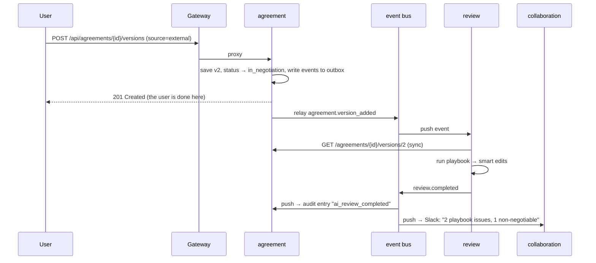
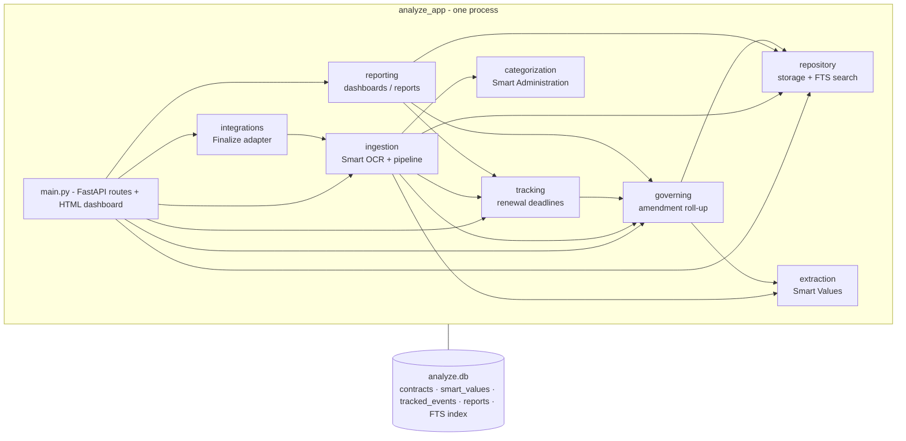

# Microservices vs. monolith: one platform built both ways

This repository implements the two halves of the LinkSquares feature overview on purpose in two different styles:

| Product area | Built as | Why this pairing is instructive |
|---|---|---|
| **Finalize** (pre-signature: intake, approvals, negotiation, AI review, collaboration) | **Microservices**: 5 domain services, an API gateway and an event bus | Its workflow crosses several teams and domains, each with its own pace of change. That is where microservices pay off, and where their costs show. |
| **Analyze** (post-signature: OCR, Smart Values, amendments, deadlines, BI) | **Modular monolith**: 1 process, 1 database | It's a data pipeline over one shared model. Every feature reads the same contract data, so splitting it would mostly add network hops. |

The two systems are linked the same way they would be in production: Analyze subscribes to Finalize's `agreement.executed` event. That shows a monolith and microservices can sit side by side.

---

## 1. How the Finalize microservices are built

```mermaid
flowchart LR
  client([Client / Word add-in / Salesforce]) -->|X-API-Key| gw[API gateway :8000]
  gw --> tpl[template service<br/>templates · Q&A · intake funnel]
  gw --> agr[agreement service<br/>state · versions · audit · hub]
  gw --> apr[approval service<br/>matrices · workflows]
  gw --> rev[review service<br/>AI summary · Q&A · playbooks]
  gw --> col[collaboration service<br/>comments · Slack notifications]
  tpl -- sync HTTP: create agreement --> agr
  rev -- sync HTTP: fetch text --> agr
  tpl & agr & apr & rev -. publish .-> bus[(event bus :8010)]
  bus -. push .-> agr & apr & rev & col
  bus -. agreement.executed .-> an[Analyze monolith :9000]
  tpl --- d1[(template.db)]
  agr --- d2[(agreement.db)]
  apr --- d3[(approval.db)]
  rev --- d4[(review.db)]
  col --- d5[(collaboration.db)]
```

### 1.1 Service boundaries follow the feature doc's capability groups (bounded contexts)

| Service | Feature-doc section | Owns (nobody else touches this data) |
|---|---|---|
| `template_service` | Standardized Intake & Generation | templates, Q&A definitions, intake requests, funneling rules |
| `agreement_service` | Version Control & Auditability, State Management | agreements, versions, status machine, audit trail, negotiation hub |
| `approval_service` | Workflow Automation & Governance | approval matrices, workflows, approval tasks |
| `review_service` | AI-Assisted Review & Playbooks | playbooks, review results; summarization and NL query |
| `collaboration_service` | Centralized Communication, Slack integration | comment threads, notifications |
| `gateway` | Native API | nothing: routing, auth, correlation ids |
| `event_bus` | (infrastructure) | subscriptions, event log, deliveries, dead letters |

A useful test for a boundary is whether a team could change the service's internals and redeploy it without coordinating with anyone. Swapping the review service's heuristics for an LLM, for example, touches only `review_service`.

### 1.2 The building blocks (and where to find them)

| Pattern | What it solves | Code |
|---|---|---|
| **Database per service** | Services can't couple through shared tables | `lscommon/store.py`: each service opens only `DATA_DIR/<service>.db` |
| **API gateway** | One public entry point; auth and tracing handled once | `services/gateway/main.py` |
| **Service discovery** | Services find each other without hard-coded hosts | `service_url()`: env vars locally, DNS names in `docker-compose.yml` |
| **Synchronous request/response** | The caller needs an answer now | `lscommon/service.py: call()`, used by template→agreement and review→agreement |
| **Asynchronous events (choreography)** | Services react to each other without calling each other | `lscommon/events.py`, e.g. approval publishes `approval.workflow_completed` and agreement moves itself to *Ready for Signature* |
| **Transactional outbox** | No event is lost if the bus is down | `Events.publish()` writes to the service's own DB and a relay loop forwards it |
| **At-least-once delivery + retries + dead letter** | Consumers that are briefly down still get their events | `event_bus/main.py: _deliver()`, `/deliveries?status=dead_letter`, `/redeliver` |
| **Idempotent consumers** | Duplicate deliveries don't double-apply | `Events.mount()` records `processed_events` |
| **Event-carried state transfer** | A consumer doesn't have to call back for data | `agreement.submitted_for_approval` carries the metadata the approval matrix needs |
| **Correlation id** | Trace one user action across services | propagated in headers and events; `GET /api/events?correlation_id=...` |
| **Health aggregation** | See which service is down | `GET /health/all` on the gateway |

### 1.3 One business action, traced across services

Submitting a counterparty redline is **one HTTP request**. What follows is a chain of reactions, and none of these services calls the next one directly:



`python demo.py` prints this trace from the bus's event log, grouped by correlation id.

### 1.4 The Finalize lifecycle as a distributed state machine

`agreement_service` owns the status. Other services only *cause* transitions by publishing events:

```
draft ──(external redline)──▶ in_negotiation ──(submit)──▶ pending_approval
                                   ▲                        │          │
                                   │          approval.rejected   approval.workflow_completed
                                   │                        ▼          ▼
                          changes_requested ◀───────────────┘   ready_for_signature ──(sign)──▶ executed
```

The approval service has no idea that an agreement *has* a status. It only announces that its workflow finished. That loose coupling is the main thing microservices give you.

---

## 2. How the Analyze monolith is built



Here is `ingestion.ingest()` from the monolith:

```python
with database.transaction() as conn:          # ONE ACID transaction
    values   = extraction.extract(text)       # function call, not HTTP
    category = categorization.categorize(text)
    parent   = governing.find_parent(conn, …) # SQL query on the shared schema
    repository.insert_contract(conn, …)
    tracking.reschedule(conn, parent or id)   # an amendment moves its parent's deadlines
```

If deadline scheduling fails, the whole contract rolls back. There is no partial state, no outbox, no retries and no eventual consistency. Reporting reads the *governing* (amended) terms by calling `governing.current_terms()` directly, so reports are always consistent with the latest amendment.

Modularity still matters inside a monolith. Each module has one job and modules call each other through a small set of functions. That discipline is what would let you extract a module into a service later: `extraction` is pure (text in, values out), so it's the obvious first candidate.

---

## 3. Side-by-side analysis

### 3.1 Measured (`python compare.py`, localhost, one machine)

| | Finalize (microservices) | Analyze (monolith) |
|---|---|---|
| Processes to run | 7 | 1 |
| Databases | 6 | 1 |
| Resident memory | ~364 MB total | ~54 MB |
| Python LOC (non-blank) | ~1,350 | ~730 |

| Operation | p50 ms | p95 ms |
|---|---|---|
| Read one record: Finalize via gateway (2 hops) | 4.3 | 5.7 |
| Read one record: Finalize service direct (1 hop) | 1.4 | 1.7 |
| Read one record: Analyze monolith | 1.8 | 2.1 |
| Create draft: Finalize intake (gateway → template → agreement) | 31.4 | 41.1 |
| Ingest + extract + classify + schedule: Analyze (1 transaction) | 5.4 | 6.6 |

How to read these numbers:
* **Each hop adds latency.** The gateway roughly triples the cost of a read. Over a real network (TLS, a service mesh, other availability zones) the gap is larger, not smaller.
* **Memory scales with the process count.** Each Python service carries its own runtime and framework, which is about 7× the footprint here.
* **Microservices need more code for the same features.** About 400 of Finalize's ~1,350 lines (30%) are pure distribution plumbing: the gateway, event bus, outbox relay, retries, idempotency, service bootstrap and discovery. The monolith needs none of it.
* **A pitfall we hit.** The first benchmark measured intake at **202 ms**. The cause was that every service-to-service call built a fresh HTTP client (about 58 ms each for TLS-context setup), and did so on the event loop. A shared, pooled client (`lscommon.service.http_client`) brought it down to about 31 ms. Distributed systems create performance problems that simply don't exist when the call is a function call.

### 3.2 Failure behaviour (all covered by `tests/test_finalize_microservices.py`)

| Scenario | Finalize (microservices) | Analyze (monolith) |
|---|---|---|
| A **synchronously-called** dependency is down (`agreement`) | Intake returns **503 "agreement service unavailable"**. Everything else (templates, approvals, review) keeps working. | n/a: the module is in-process |
| The **event bus** is down | Writes still succeed. Events wait in each service's **outbox** and flow once the bus returns. Nothing is lost. | n/a |
| A **consumer** is down (`collaboration`) | Approvals complete normally. Notifications arrive **after restart** because the bus retries. | n/a |
| The **process** crashes | Only that capability is lost | **Everything** is down: ingestion, search, dashboards, integrations |
| Bad deploy | Roll back one service | Roll back the whole application |

This is the key trade-off. Microservices give you **partial availability and independent failure**, but you have to design for it. The monolith has **one failure domain** and far fewer ways to fail.

### 3.3 Qualitative trade-offs

| Dimension | Microservices (Finalize) | Monolith (Analyze) |
|---|---|---|
| **Deployment** | Each service ships independently, so teams move at their own pace. You need CI/CD per service plus orchestration (compose/Kubernetes). | One artifact and one pipeline. Every change redeploys everything. |
| **Scaling** | Scale the hot part only. For example, run 10 review replicas for AI load and 1 template replica. | Scale the whole app. Fine until one feature's load profile dominates. |
| **Data consistency** | Eventual. Each service owns its data. Cross-service workflows are sagas/choreography (the approval → agreement status flow). Tests must *poll* (`eventually()`). | ACID across all features. Joins across modules are one SQL query. |
| **Queries across domains** | Hard. "Show agreements with pending finance approval and an AI issue" needs API composition or a read model built from events. | Trivial SQL (see `reporting._rows`). |
| **Development** | Clear ownership, small codebases, freedom in tech stack per service. You pay in contracts, versioning and integration tests. | Easy refactoring (the IDE sees everything), simple debugging, one test run. Boundaries can erode without discipline. |
| **Testing** | Unit tests per service **plus** multi-process end-to-end and failure-injection tests | In-process `TestClient`, no network, fast |
| **Observability** | Needs correlation ids, distributed tracing and centralized logs. We implemented the minimum. | One log and one stack trace |
| **Security** | Every service is a network endpoint. Needs service-to-service auth (mTLS/JWT); here the gateway guards only the edge. | One perimeter |
| **Operational cost** | 7 processes, 6 databases, a broker, and dead-letter handling | 1 process, 1 database |
| **Team fit** | Several teams, each owning a capability | One team, or an early-stage product |

### 3.4 Why each part of the product fits its style

**Finalize suits microservices because:**
* Its capabilities have **different owners and change rates**. Legal ops tunes approval matrices and playbooks. The AI team iterates on review models. The integrations team adds Salesforce/DocuSign/Slack.
* Its load is **uneven**. AI review is CPU- or GPU-heavy and bursty, while templates are cheap reads.
* The workflow is naturally **event-driven**: "when approvals clear, move to signature" and "when a redline arrives, review it".
* Integrations (Word add-in, Salesforce, Slack, e-signature) map cleanly onto gateway routes and event subscribers.

**Analyze suits a monolith because:**
* Every feature reads the **same core data**. Smart Values, governing summaries, deadlines and dashboards all read the same contracts. Splitting them means copying the data between services or making a network call for every read.
* **Correctness depends on consistency.** An amendment must update the governing terms, deadlines and reports together, in one transaction.
* Analytics is **query-heavy across the whole dataset**, which is exactly what a single relational schema is good at.

### 3.5 When to switch

* **Monolith → microservices** (the "strangler fig" pattern): extract a module when it needs to scale separately, is owned by a separate team, or deploys much more often than the rest. In Analyze, the first candidate is `extraction` + OCR: CPU-heavy, pure functions, easy to put behind a queue. `integrations.py` already shows the pattern of a monolith consuming events at its edge.
* **Microservices → monolith** (it happens): if the services are always deployed together, share a database, or chat synchronously on every request, you have a *distributed monolith*. That gives you both sets of costs, so merge them. Our template→agreement sync call is the seam to watch.

### 3.6 What production would add (deliberately left out)

| Here | Production |
|---|---|
| `event_bus` service (HTTP push) | Kafka / RabbitMQ / SNS+SQS, with per-key ordering (events for one agreement are *not* guaranteed ordered here) |
| SQLite per service | Postgres per service (or schema per service), migrations per service |
| API key at the gateway | OAuth/OIDC at the edge, mTLS or signed JWTs between services |
| Correlation id | OpenTelemetry tracing, centralized logs and metrics |
| Env-var discovery / compose | Kubernetes services, health probes, autoscaling, service mesh |
| Retries in the bus only | Timeouts, circuit breakers and bulkheads on sync calls too |
| Heuristic "AI" | An LLM behind `review_service` and `analyze_app.extraction`, same interfaces |
| Folder sync | Real S3/Drive/SharePoint/Box connectors |
